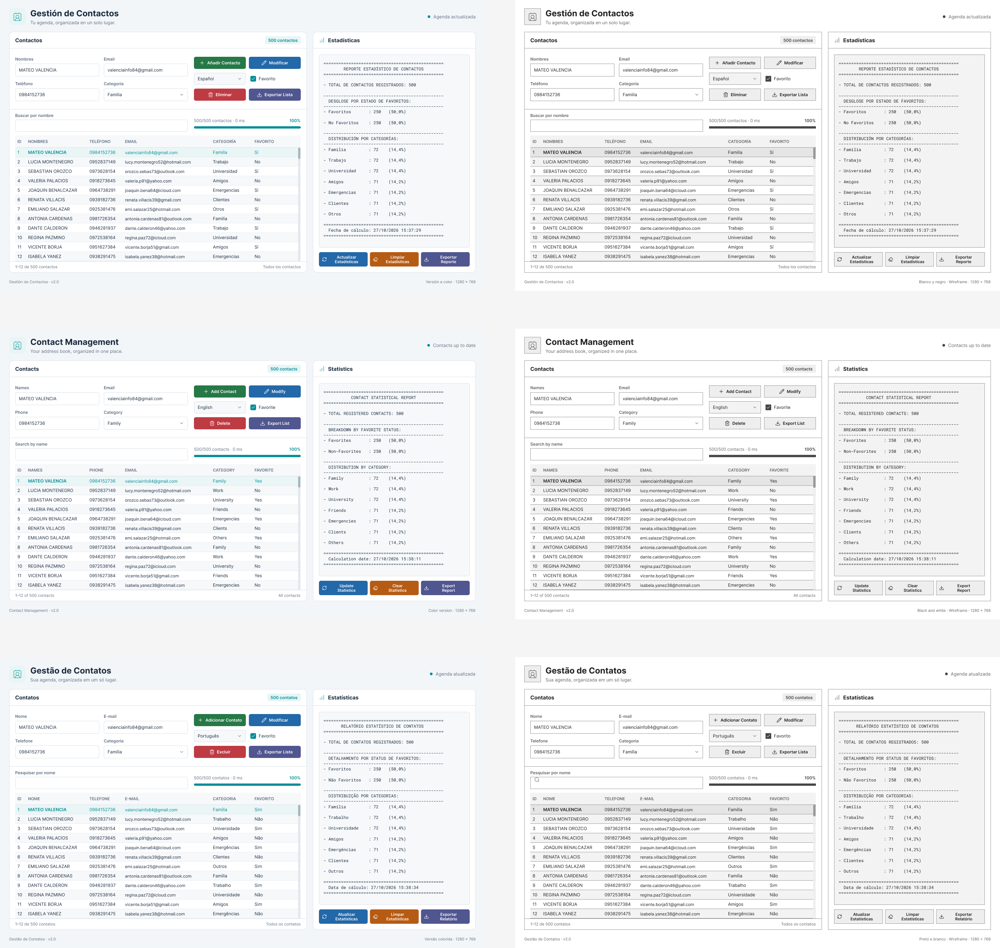

# Sistema de Gestión de Contactos (Diseño y Construcción de Interfaces Gráficas)

**Proyecto de la Unidad 2 que implementa un sistema avanzado de gestión de contactos con Java, Maven, interfaz gráfica optimizada en Java Swing, soporte multiidioma dinámico y persistencia local.**

El desarrollo aplica estrictamente el patrón de arquitectura **MVC (Modelo-Vista-Controlador)** y utiliza `ResourceBundle` para la internacionalización en tiempo real (Español, Inglés y Portugués), garantizando una experiencia de usuario altamente adaptativa y profesional.

---

### ⚙️ Características Técnicas

*   **Arquitectura MVC Estricta:** Separación modular entre la interfaz gráfica (`vista`), la lógica de eventos y control de flujos (`controlador`), y las entidades con persistencia de datos (`modelo`).
*   **Motor i18n Multinivel:** Soporte completo e interactivo para Español, Inglés y Portugués mediante `ResourceBundle`, permitiendo alternar el idioma de todos los componentes gráficos al instante.
*   **Gestión CRUD Completa:** Operaciones de creación, lectura, actualización y eliminación de registros optimizadas con validaciones rigurosas.
*   **Interfaz de Usuario Avanzada (Swing / IntelliJ GUI Forms):** Estructura en pestañas (`JTabbedPane`), tablas interactivas (`JTable`) con ordenamiento por columnas y filtrado en tiempo real.
*   **Accesibilidad y UX Interactiva:** Menú contextual por clic derecho (`JPopupMenu`), atajos de teclado avanzados mapeados mediante `InputMap`/`ActionMap`, y barra de progreso (`JProgressBar`) para la carga de datos.
*   **Persistencia y Analítica:** Manejo eficiente de archivos en texto plano (`tabla_contactos.csv`) y generación automatizada de reportes estadísticos exportables (`reporte_estadisticas.txt`).
*   **Codificación UTF-8:** Soporte nativo para caracteres especiales, tildes y variantes idiomáticas.

---

### 🛠️ Requisitos Previos
Para compilar y ejecutar este proyecto correctamente, asegúrate de tener instalado:
*   **Java Development Kit (JDK):** Versión 27 (o compatible con Java 21+).
*   **Apache Maven:** Gestor de dependencias y construcción de proyectos.
*   **Entorno de Desarrollo (IDE):** IntelliJ IDEA (recomendado con soporte para IntelliJ GUI Designer).

---

### 📂 Estructura del Proyecto (MVC)
El código fuente está organizado bajo la siguiente estructura modular:

```text
src/
├── main/
│   ├── java/
│   │   ├── controlador/
│   │   │   └── LogicaVentana.java    # Control de eventos, traducciones y nexo UI-Datos
│   │   ├── modelo/
│   │   │   ├── Persona.java          # Entidad de datos del contacto
│   │   │   └── PersonaDAO.java       # Lógica de acceso a datos y persistencia CSV
│   │   └── vista/
│   │       ├── ventana.java          # Clase principal y punto de arranque de la aplicación
│   │       └── base/
│   │           ├── VentanaUI.java    # Configuración de componentes y mapeo base
│   │           └── VentanaUI.form    # Diseño visual de la interfaz gráfica
│   └── resources/
│       ├── files/
│       │   ├── tabla_contactos.csv         # Archivo de persistencia de contactos
│       │   └── reporte_estadisticas.txt    # Reporte automatizado de métricas
│       ├── i18n/
│       │   ├── mensajes_es.properties      # Textos e internacionalización en Español
│       │   ├── mensajes_en.properties      # Textos e internacionalización en Inglés
│       │   └── mensajes_pt.properties      # Textos e internacionalización en Portugués
│       └── images/
│           └── icons/
│               └── gestion.png             # Icono institucional de la aplicación
└── pom.xml                                 # Configuración y dependencias Maven
```

---

### 🖥️ Pantallas de Ejecución

#### 1. Aplicación en el Idioma Español


#### 2. Aplicación en el Idioma Inglés


#### 3. Aplicación en el Idioma Portugués


### 📥 ¿Cómo obtener el proyecto?

Para clonar el repositorio de forma local, abre una terminal y ejecuta:
```bash
git clone [https://github.com/20Martin05/Diseno-y-Construccion-de-Interfaces-Graficas.git](https://github.com/20Martin05/Diseno-y-Construccion-de-Interfaces-Graficas.git)
cd Diseno-y-Construccion-de-Interfaces-Graficas
```

También puedes descargar el proyecto comprimido en formato ZIP directamente desde GitHub y descomprimirlo en tu equipo.

---

### 🎨 Prototipado y Diseño Visual (Figma)

Antes de la implementación en Java Swing, se diseñó la arquitectura visual y el flujo de navegación de la aplicación:

*   **Wireframes:** Esquemas estructurales iniciales para definir la distribución de la tabla, paneles y campos del formulario.
*   **Mockups:** Diseño de alta fidelidad con la paleta de colores accesible, tipografía `Segoe UI` e iconos institucionales.
*   **Prototipo Interactivo:** Versión navegable implementada en Figma para validar el comportamiento del `JTabbedPane` y el cambio dinámico de idioma (`ResourceBundle`).

#### Vista previa del Prototipo en Figma


> 🔗 **Enlace al proyecto en Figma:** https://www.figma.com/design/QgQmY2vxKg7GL6av5ryJzb/Dise%C3%B1o-y-Construcci%C3%B3n-de-Interfaces-Gr%C3%A1ficas?node-id=0-1&t=0FKjo7OiWc7pVb6z-1

### ▶️ Compilar y Ejecutar

1. Abre el proyecto en IntelliJ IDEA seleccionando el archivo pom.xml como proyecto Maven.
2. Comprueba que la carpeta src/main/resources esté configurada como Resources Root (Mark Directory as -> Resources Root).
3. Ejecuta la clase principal de arranque:
   ```text
   src/main/java/vista/ventana.java
   ```
Si prefieres compilarlo directamente desde la terminal con Maven:
```bash
mvn clean package
```
### 🚀 Instrucciones de Uso

* **Agregar Contacto:** Rellena los campos obligatorios del formulario (Nombres, Teléfono, Correo Electrónico), selecciona la categoría correspondiente, marca la opción de favorito si aplica y haz clic en el botón de agregar. El registro aparecerá de inmediato en la tabla inferior.
* **Modificar Registro:** Selecciona un contacto haciendo clic sobre su fila en la tabla; sus datos se cargarán automáticamente en el panel superior para su edición. Realiza los cambios necesarios y pulsa modificar.
* **Eliminar Registro:** Selecciona el contacto objetivo en la tabla y presiona el botón de eliminar (o la tecla `Supr`).
* **Cambio de Idioma:** Utiliza el selector de idioma integrado en la interfaz para alternar dinámicamente entre Español, Inglés y Portugués en tiempo real.
* **Atajos de Teclado Disponibles:**
    * `Ctrl + G`: Agregar nuevo contacto.
    * `Ctrl + S`: Modificar contacto seleccionado.
    * `Supr / Delete`: Eliminar contacto seleccionado.
    * `Ctrl + E`: Exportar registros.
    * `Ctrl + F`: Buscar en la tabla.
    * `Escape`: Deseleccionar fila actual.

### 👤 Autor

* **Desarrollado por:** Martin Rody Rosero Játiva
* **Materia:** Programación de Interfaces Gráficas
* **Universidad:** Universidad Politécnica Salesiana
* **Nivel / Bloque:** Tercer Semestre - Bloque I (Unidad 2)